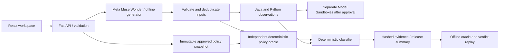

# Architecture and decision rules

## Trust boundaries

The local simulator is a labeled substitute for the execution boundary, restricted to fixed reviewed behaviors. It never evaluates source text. Tests separately compile/run the checked-in Java/Python fixtures and compare their observations to the simulator. The oracle imports neither implementation fixture nor model output.

## Policy semantics

A policy has an immutable ID/version, approval status, inclusive `effective_from`, exclusive optional `effective_until`, due-date selection, grace days, fee cents and approval provenance. Approved periods cannot overlap. A `supersedes` link must refer to an approved lower version ending exactly when the new version begins. Gaps are allowed and yield insufficient evidence. Draft policies are never authoritative. Effective and approval dates use the same strict 2000–2100 ISO calendar-date contract as test inputs, and blank provenance is rejected. API writes create whole new snapshots; existing snapshots and bundled evidence remain unchanged.

Calendar lateness is `max(0, payment_date - due_date)` in integer days. The single fee applies only when lateness is strictly greater than grace. V1 covers supplied dates 2026-01-01 through 2026-10-31 (5 days, 2500 cents); V2 covers due dates from 2026-11-01 (7 days, same fee). Earlier dates have no evidence in this synthetic dataset.

## Classification precedence

| Condition | Verdict |
| --- | --- |
| Input cannot be validated | Invalid input; no execution |
| Either implementation fails, times out or emits an invalid fee | Execution failure |
| No unique approved policy applies | Insufficient policy evidence |
| Both observations equal current oracle | Compliant |
| Legacy equals current oracle, updated differs | Unauthorized regression |
| Neither observation equals current oracle | Both implementations wrong |
| Updated equals current oracle; legacy matches the explicit predecessor's different result | Authorized policy change |
| Updated equals current oracle; legacy differs without that predecessor evidence | Corrected legacy defect |

Authorized change is an explanation for this observed input, not proof that legacy correctly implemented all predecessor rules. Agreement between implementations alone is never evidence of compliance. A $0 result is not interchangeable with a missing/failed result.

## Generation and execution

Muse Wonder gets synthetic code and optionally policy context, not credentials. It returns hypotheses with dates and brief rationales. Expected values and verdicts are excluded from the schema. The HTTP client pins the official Meta origin, blocks redirects/proxy inheritance, caps token and response sizes, and does not retry paid requests. Incomplete/refused/malformed responses are rejected.

Modal is lazy: credential checks and explicit paid gates precede even app lookup. Each implementation/case uses a fresh sandbox; no local source tree, `.env`, secret object, volume or identity token is mounted. The remote image includes only Python and, for Java, a JDK. Runtime network access is blocked. The remote root supervisor drops child groups/GID/UID and bounds stdout/stderr files, CPU, process count and file descriptors, invokes without a shell, applies compile/run deadlines and kills process groups. The outer sandbox has memory/CPU/lifetime limits and is terminated in `finally`. Live effectiveness remains unverified until a paid integration pass.

## Replay and release

Reports persist UTC timestamps, selected cases, source text and SHA-256 fingerprints, full policy snapshot and fingerprint, oracle algorithm version, observations, calculations, verdicts, generation receipt and summary. Local JSON writes use a temporary file plus atomic replacement; random record IDs prevent path traversal. Records are private (0600) in a private directory (0700). A report-level digest detects accidental corruption.

Replay validates the saved record and recomputes the oracle and classifications from the saved policy and observations. It **does not rerun Java/Python or contact Meta/Modal**. A fresh execution requires a new verification request and its normal gate. Invalid-case raw payloads are intentionally not stored; their invalid-input verdicts are retained.

In the legacy compatibility summary, any regression, both-wrong finding or execution failure yields **hold**. Otherwise insufficient evidence or invalid input yields **review**. Only fully supported passing tested cases yield **pass**. Simulation mode is explicitly retained in the report regardless of decision. The authoritative advisory is now `release.outcome`; green simulator runs are UNVERIFIED and missing evidence requires REVIEW. See POLICY_MODEL.md.

## Runtime and storage scope

The app serves one local user via loopback. Vite proxies `/api`; browser origins and hostnames are restricted, requests capped at 256 KB, and validation errors omit raw inputs. Local JSON storage avoids additional services. This is a source-checkout application: fixture/policy data live alongside the package. Public hosting requires authentication, authorization, tenant isolation, authenticated policy approvals, quotas, durable audit storage and a separate deployment review.

## Report context in the UI

The editable draft and saved run are labeled separately. Opening history preserves the draft and displays the saved run's actual execution note, source text, policy snapshot and fingerprints in a read-only inspector. A new execution uses **Run current draft**. Finding filters select an included case or clear evidence when no cases match. Existing saved policy snapshots can be reselected after reload, or the draft can return to bundled policy evidence.

The senior hardening design, trust boundaries, lifecycle and current contracts are maintained
in [HIGH_LEVEL_DESIGN.md](HIGH_LEVEL_DESIGN.md). The authoritative classification and advisory
decision tables are in [POLICY_MODEL.md](POLICY_MODEL.md).
