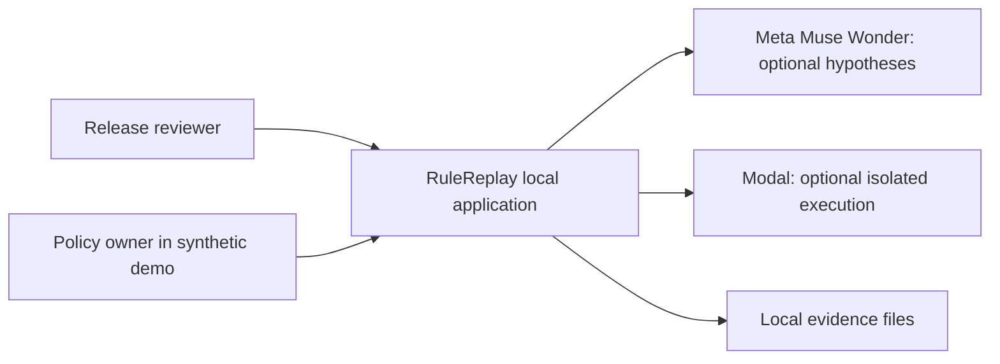
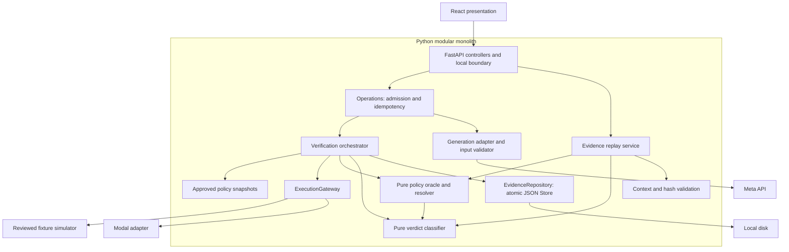
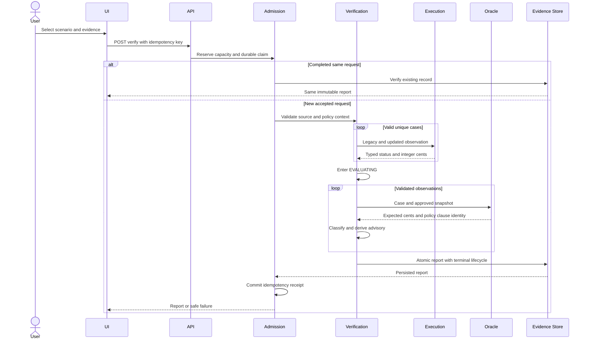
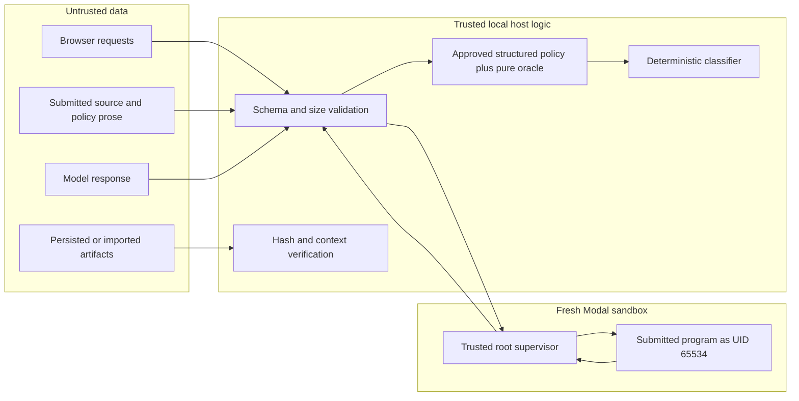
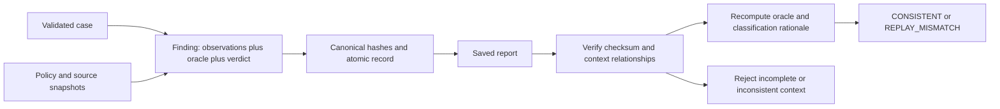
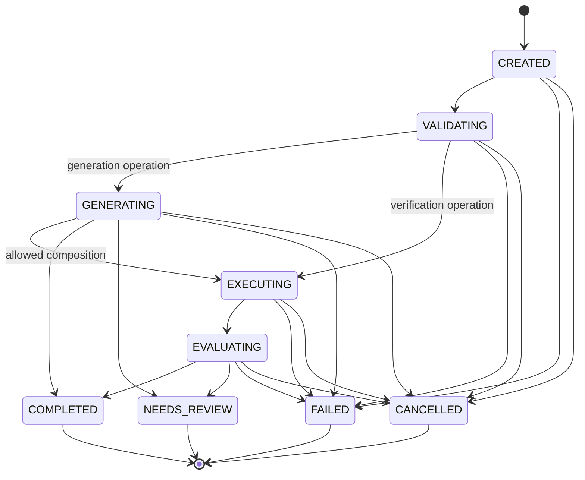

# RuleReplay high-level design

## System overview and scope

RuleReplay helps a release reviewer compare legacy Java, updated Python and approved,
versioned financial policy. Its demonstration is a fictional USD flat late fee whose
five-day grace period becomes seven days for **due dates** on/after 2026-11-01.
The user selects fixtures or submits source, chooses a policy snapshot and a test suite,
and inspects deterministic findings. Nothing deploys software or grants release approval.

One React application calls one synchronous FastAPI process on loopback. Meta Muse Wonder
is an optional external hypothesis generator. Modal is the only execution environment for
submitted source. Both integrations require independent server-side paid gates and private
credentials. Trusted fixture simulation works without either service. External provider
behavior is mock-tested; live validation is outstanding.

## Functional requirements actually supported

- Select five synthetic scenarios and inspect/edit their Java/Python source.
- Save validated policy snapshots without changing bundled policy history.
- Generate deterministic offline boundaries or explicitly gated Meta test inputs, with/without
  policy context. Save generation receipts and rejection counts/reasons.
- Verify explicit inputs, a saved generation or default boundaries. Submitted source requires
  Modal; simulator source is repository-owned behavior only.
- View findings, clauses, source/policy fingerprints, mode, run/correlation IDs, lifecycle,
  advisory outcome, test source and timing. Filter findings and download JSON.
- Browse recent immutable reports, replay saved observations through the oracle/classifier,
  and minimize counterexamples only for trusted simulator runs.
- Reproduce a fixed-budget seeded-defect benchmark with unmeasured live AI rows clearly marked.

## Nonfunctional requirements and limits

| Concern | Mechanism and practical limit |
| --- | --- |
| Security | Strict schemas, origin/host checks, bounded bodies, no credentials/tools in model context, remote-only untrusted execution. Trusted local user is assumed. |
| Reliability | Atomic reports, durable idempotency claims, typed errors and bounded synchronous admission. No background job queue, HA or crash-resume scheduler. |
| Determinism | Integer cents, calendar dates, explicit policy intervals; oracle and classifier are pure functions. Provider output and timing are not deterministic. |
| Maintainability | Modular monolith, two typed I/O ports, AST import-boundary/cycle tests; no service mesh or database dependency. |
| Observability | Safe JSON log events, correlation IDs, lifecycle timestamps, counts and durations; no uploaded source or full provider payload in logs. |
| Performance | At most 48 inputs; Modal at most 16 cases/32 isolated executions, sequential. No latency SLO for unvalidated cloud cold starts. |
| Resource efficiency | One process, file storage and small dependency sets; reuse installed Chrome for E2E, no model weights or local Docker. |
| Auditability | Canonical SHA-256, nested context checks, captured source/policy snapshots and versioned oracle/harness metadata. Hashes are not signatures. |
| Availability | Local disk and one backend process are single points of failure. External providers may be unavailable; no fallback masquerades as live evidence. |

## Architecture diagrams

### System context



### Containers and components



### Analysis sequence



### Trust boundaries



The root supervisor exists only inside the remote sandbox. Host execution of submitted
code is forbidden. No volumes, credentials, OIDC identity or network access are granted.
The structured policy registry is locally user asserted: organizational approval is not
cryptographically authenticated by this prototype.

### Finding and replay flow



### Lifecycle



Generation and verification are separate synchronous API operations; each gets its own
trace. An optional saved generation receipt connects them. A graceful interruption can
record CANCELLED; a hard kill leaves an ACCEPTED claim requiring operator review. There
is no browser cancellation endpoint. COMPLETED means evaluation was persisted, not that
release is approved: a conclusive FAIL with complete evidence also completes. Any missing
required evidence keeps lifecycle NEEDS_REVIEW even when another finding makes release FAIL.

## Responsibility boundaries

| Logical responsibility | Actual implementation | Authority |
| --- | --- | --- |
| Frontend presentation | `frontend/src/App.tsx`, `types.ts`, `api.ts` | Displays server findings; cannot establish policy verdicts |
| API/controller | `api.py`, `main.py`, `security.py` | Validate requests, route, sanitize errors |
| Analysis orchestrator | `verification.py`, `operations.py`, `lifecycle.py` | Order stages, reserve resources, persist outcomes |
| PolicyRepository | `policies.load_policies`, `Store` policy sets | Supplies validated immutable snapshots |
| PolicyResolver and PolicyOracle | `oracle.evaluate` | Select one approved interval by due date; calculate cents |
| TestPlanner / Meta adapter | `generation.generate_meta`, `offline_cases` | Hypotheses only, no verdict or expected-value fields |
| TestCaseValidator | `domain.TestCase`, `normalize_cases` | Reject invalid shape/dates/IDs; deduplicate |
| ExecutionGateway | `contracts.ExecutionGateway`, `ModalExecutor`, simulator | Supplies observations; no policy selection imports |
| Modal execution | `execution.py`, `sandbox_runner.py` | Bound and isolate hostile source; observations remain untrusted evidence |
| VerdictClassifier | `classify.classify` | Deterministic decision table from validated evidence |
| EvidenceRepository | `contracts.EvidenceRepository`, `storage.Store`, `integrity.py`, `evidence.py` | Persist and validate context; not a signature authority |
| ReplayService | `verification.replay` | Recompute deterministic evidence without code/model reruns |
| Evaluation framework | `benchmark.py`, `tests/` | Measure controlled faults, controls and reproducibility |

The oracle imports only domain contracts; the classifier likewise. Hashing has no provider
imports. AST tests guard those edges and import cycles. No redundant repository/service
classes wrap every pure function.

## Data contracts

All examples are synthetic. Pydantic rejects unknown fields on domain/request models.
Dates are YYYY-MM-DD in 2000–2100; policy intervals are half-open. JSON reports serialize
immutable Python tuples as arrays.

| Contract | Fields and invariants |
| --- | --- |
| Policy version | `id`, integer `version`, `status`, `effective_from`, nullable exclusive `effective_until`, fixed `selection_basis=due_date`, `grace_days` 0–60, integer `fee_cents` 0–100000, `currency=USD`, `supersedes`, approval provenance. Unique IDs/versions; approved periods cannot overlap. |
| Test case | `id` (1–64 alphanumeric/underscore/hyphen), `due_date`, `payment_date`, bounded `rationale`. No expected fees, commands, account balances or verdict fields. |
| Execution request | Gateway receives fixed `java`/`python`, bounded source, validated TestCase; remote argv consists of fixed commands and canonical dates. |
| Execution result | `status=ok/error/timeout`, bounded integer `fee_cents` only for success, bounded safe `error`, finite nonnegative `duration_ms`. |
| Oracle result | `supported`, `fee_cents`, `policy_id`, `days_late`, `grace_days`, explanation and optional predecessor ID/fee pair. Supported results require complete policy evidence. |
| Classification | Finding holds `case_id`, case, oracle, legacy/updated observations, `verdict`, deterministic `reason`. Invalid-input findings have no financial evidence. |
| Evidence manifest | Embedded in run: exact sources/policies, per-source SHA-256, canonical policy SHA-256, outer `integrity_sha256`, oracle/classifier versions, runtime/harness hash, generation receipt. |
| Analysis run | UUID record ID, correlation ID, UTC timestamp, scenario/mode/test source, findings, legacy summary, advisory release, lifecycle/history and metrics. |
| API error | `{"detail":"safe message","code":"invalid_request","fields":["body.mode"]}`. Other codes include `configuration_error`, `generation_failed`, `invalid_evidence`, `operation_rejected`, `storage_unavailable`, `internal_error`. Boundary errors have safe `detail`. |

Example request: `POST /api/verify`, header `Idempotency-Key: example-run-0001`, body:

```json
{"mode":"simulator","scenario":"payment_date_bug","cases":[{"id":"transition","due_date":"2026-10-30","payment_date":"2026-11-05"}]}
```

Expected observations: legacy 2500, updated 0, oracle 2500, `unauthorized_regression`.
Advisory `FAIL` is scoped to simulator observations, and does not claim real source execution.

## Tradeoffs and production gaps

A modular monolith keeps the oracle, classification and evidence changes transactional in
one understandable process. External inference avoids model weights; external sandboxing
keeps arbitrary source off the laptop. Local JSON makes evidence portable and inspectable,
but cannot provide cross-user authorization, signed approvals, transactions across multiple
files, retention quotas or high availability. Admission/budgets assume **one backend process**.

Production deployment needs authenticated policy approval, user/tenant isolation, persistent
provider-budget accounting, enforced deployment-level request deadlines, provider smoke tests,
report signing/key custody, backups/retention, and monitoring. Current SDK RPC/image provisioning
can outlast the remote process deadline; network loss can leave cleanup dependent on the
sandbox lifetime cap. No enterprise certification or universal correctness claim is made.
